# Slab grade optimization and catalog consolidation for a heavy plate mill

How 59 historical slab chemistries fold into eight base platforms: how unsupervised clustering groups
the grades, how mathematical chemistry optimization establishes disciplined operational aim windows,
what the thermomechanical rolling levers do to the strength, how the machine learning surrogate predicts
yield and tensile properties across gauges, and how Monte Carlo simulation verifies Six Sigma process
capability. One standalone notebook, complete anonymized production data, and 27 standalone figures.

In heavy plate rolling, carrying dozens of distinct internal slab chemistries creates continuous caster
scheduling bottlenecks and dead stock in the slab yard. Analyzing the mill database revealed that 59
internal grade codes were being cast to fulfill commercial orders that actually map into just five core
mechanical requirement groups.

## Run it

[](https://colab.research.google.com/github/daniswaramp/steel-slab-grade-optimization/blob/main/Grade_Optimization.ipynb)

Colab or a standard Python scientific environment already carries numpy, scipy, pandas, matplotlib,
seaborn and scikit-learn. To run locally:

```bash
pip install -r requirements.txt
jupyter lab Grade_Optimization.ipynb
```

## What is here

```text
Grade_Optimization.ipynb    the complete model: exploratory analysis to Monte Carlo capability verification
DATABASE_ANON.xlsx          anonymized production plate dataset (17,511 records x 60 columns)
SPECIFICATION LIST.xlsx     normative delivery specification ceilings and standard boundaries
figures/                    27 standalone high-resolution figures (fig_01.png through fig_27.png)
requirements.txt
README.md
```

## The master portfolio

Consolidating thin and medium gauges (6 to 40 mm) into five shared platforms while keeping three dedicated
heavy-gauge chemistries (>= 50 mm) covers 99.5 per cent of all historical plate production:

| Grade | Name | Gauge Tier | Primary Route | Yield Strength | Tensile Strength | Standard Specifications Covered |
| :--- | :--- | :--- | :--- | :--- | :--- | :--- |
| **G1** | MS Base C-Mn | T1+T2 (6 to 40 mm) | AR / CR | >= 275 MPa | 410 to 540 MPa | JIS SS400, ASTM A36, SA283 Gr C, ABS Gr A |
| **G2** | HS C-Mn Structural | T1+T2 (6 to 40 mm) | CR | >= 355 MPa | 500 to 630 MPa | EN S355JR/J0, JIS SM490A/B, SA516 Gr 65 AR |
| **G3** | HSLA V-Microalloyed | T1+T2 (6 to 40 mm) | CR / TMCP | >= 355-380 MPa | 500 to 620 MPa | ASTM A572 Gr 50, JIS SM490YA/YB, CSA 350W |
| **G4** | HSLA Low-C Nb-Ti TMCP | T1+T2 (6 to 40 mm) | TMCP (ACC) | >= 370 MPa | 520 to 630 MPa | EN S355J2/K2/M/ML, ABS DH36/EH36, API 5L X52M |
| **G5** | PV Low-C Nb-Ti Dual | T1+T2 (6 to 40 mm) | CR / Normalized | >= 300 MPa | 520 to 620 MPa | ASME SA516 Gr 60/65/70 + N, EN 10028-3 P275/P355 |
| **G6** | Heavy MS Base C-Mn | T3 (>= 50 mm) | CR / AR | >= 275 MPa | 410 to 540 MPa | JIS SS400 Heavy, ASTM A36 Heavy |
| **G7** | Heavy HS/PV C-Mn-V | T3 (>= 50 mm) | Normalized | >= 300-355 MPa | 520 to 640 MPa | Heavy SA516 Gr 70 + N, EN 10025-3 S355N |
| **G8** | Heavy HSLA Nb-V-Ti | T3 (>= 50 mm) | Normalized / TMCP | >= 355-370 MPa | >= 550 MPa | High-Strength Heavy Structural & Pressure Vessel |

The remaining 0.5 per cent of plates represent specialty weathering steel (Cu-Ni-Cr) and high-carbon tooling grades (S45C) that are intentionally preserved as bespoke melt orders.

A Pareto distribution confirms the extreme volume skew: eight grades represent 87.1 per cent of all plate tonnage, while dozens of niche grades were cast in single-digit batches.

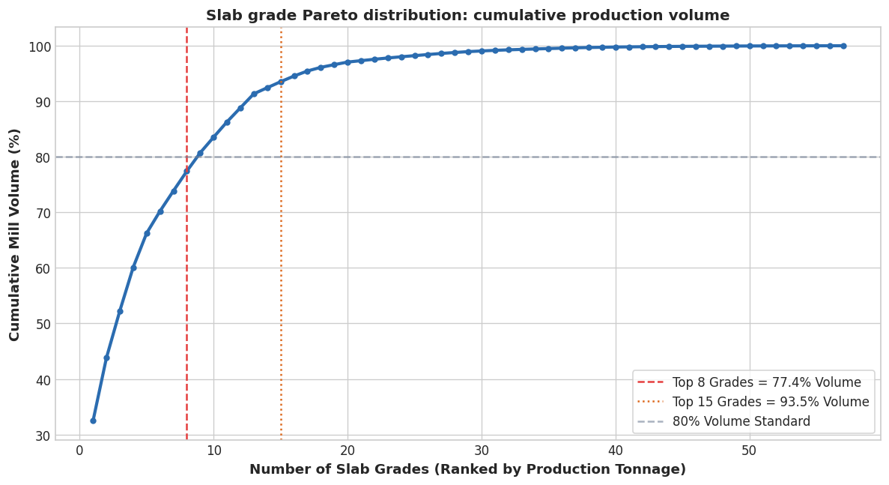

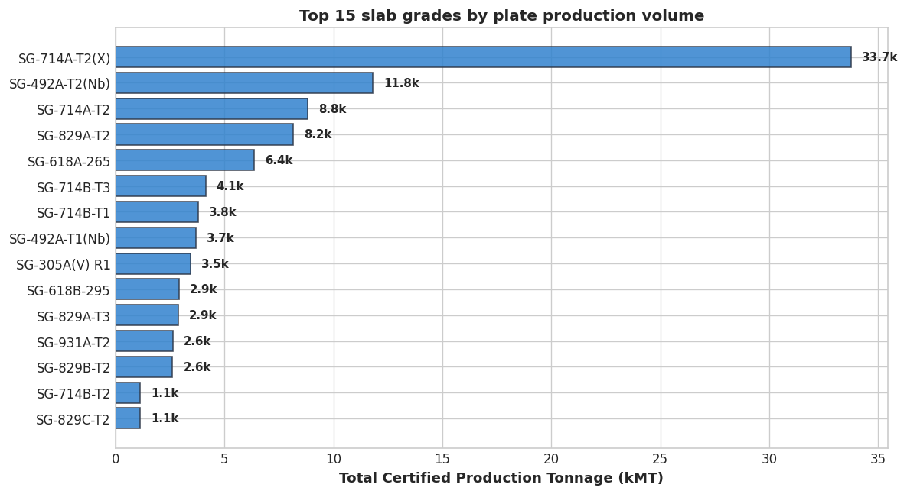

Merging thin (6 to 20 mm) and medium (20 to 40 mm) gauges eliminates redundant grade variants that share identical chemistry. Heavy plates (>= 50 mm) require separate chemistries due to reduced total drafting and slower cooling rates.

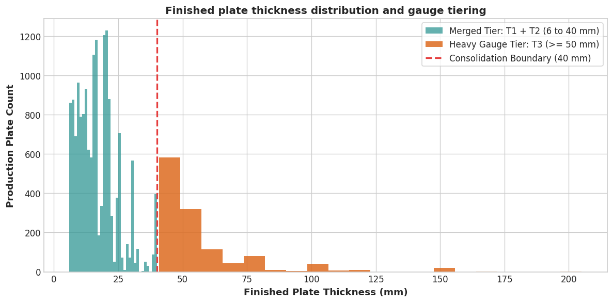

## Chemistry clustering

To avoid arbitrary grouping boundaries, we evaluate unsupervised clustering across ten chemical dimensions (`C`, `Mn`, `Si`, `Nb`, `V`, `Ti`, `Cu`, `Cr`, `Ni`, `CE`).

Ward's minimum variance linkage dendrogram reveals how historical grades merge into natural metallurgical branches:

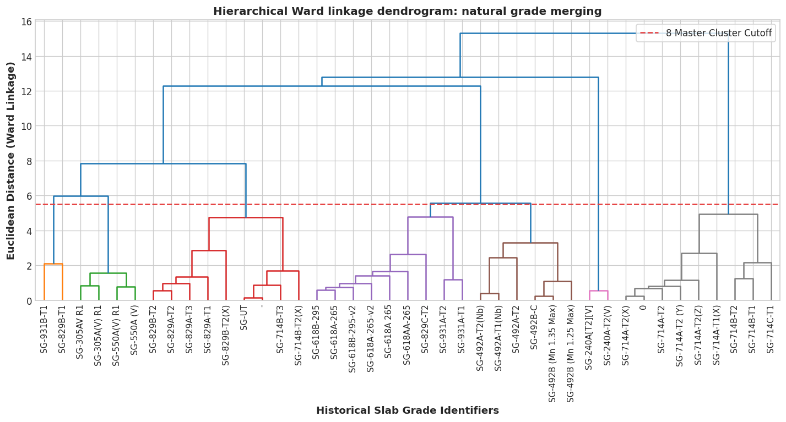

Principal component analysis identifies the dominant vectors: PC1 carries bulk solid-solution alloying ($C + Mn$), while PC2 discriminates between microalloying systems ($Nb$ vs $V$).

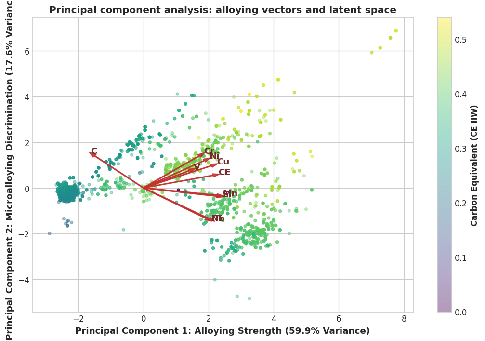

Microalloying element interactions show clean separation between lean structural grades, vanadium additions for precipitation hardening, and niobium-titanium pairs for grain refinement:

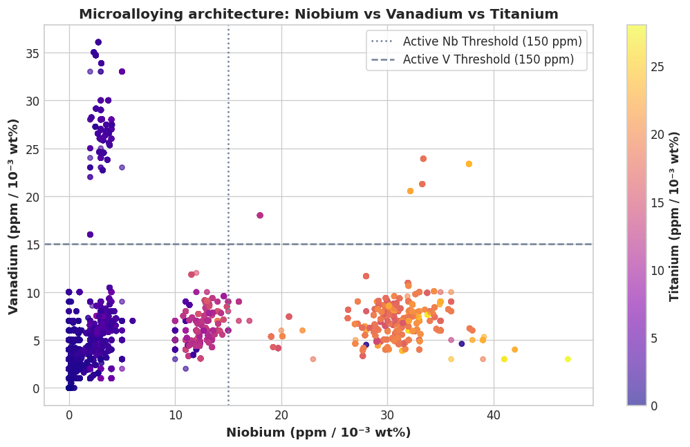

## Chemistry optimization

Rather than using raw empirical cluster medians as casting targets, we formulate a constrained mathematical optimization for each master grade using `scipy.optimize` (SLSQP). The objective function maximizes weldability clearance ($CE_{\mathrm{spec}} - CE$ and $P_{cm,\mathrm{safe}} - P_{cm}$) while enforcing $2.5\sigma$ process safety margins against governing standard ceilings under ladle refining analytical variance:

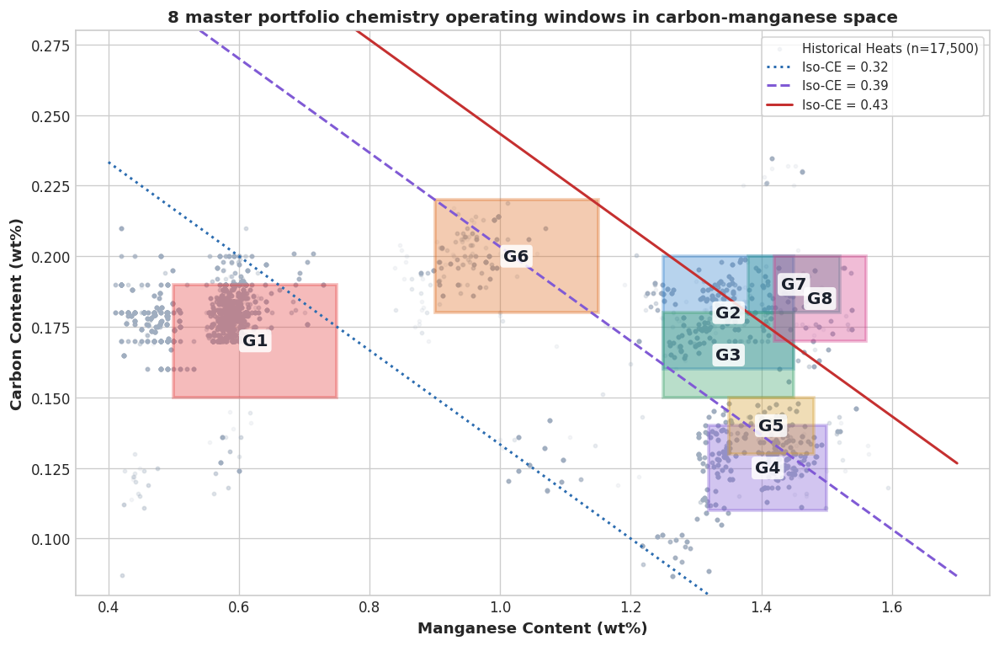

The optimization replaces erratic historical practice with tight, disciplined operating aim points:

| Grade | Platform Name | Gauge Tier | Aim C | Operating C Window | Aim Mn | Operating Mn Window | Aim CE | CE Ceiling | Weld Buffer |
| :--- | :--- | :--- | :--- | :--- | :--- | :--- | :--- | :--- | :--- |
| **G1** | MS Base C-Mn | T1+T2 (6 to 40 mm) | 0.170% | 0.15 to 0.19% | 0.625% | 0.50 to 0.75% | 0.303 | <= 0.32 | +0.017 |
| **G2** | HS C-Mn Structural | T1+T2 (6 to 40 mm) | 0.180% | 0.16 to 0.20% | 1.350% | 1.25 to 1.45% | 0.434 | <= 0.43 | +-0.004 |
| **G3** | HSLA V-Microalloyed | T1+T2 (6 to 40 mm) | 0.165% | 0.15 to 0.18% | 1.350% | 1.25 to 1.45% | 0.424 | <= 0.44 | +0.016 |
| **G4** | HSLA Low-C Nb-Ti TMCP | T1+T2 (6 to 40 mm) | 0.125% | 0.11 to 0.14% | 1.410% | 1.32 to 1.50% | 0.389 | <= 0.39 | +0.001 |
| **G5** | PV Low-C Nb-Ti Dual | T1+T2 (6 to 40 mm) | 0.140% | 0.13 to 0.15% | 1.415% | 1.35 to 1.48% | 0.405 | <= 0.41 | +0.005 |
| **G6** | Heavy MS Base C-Mn | T3 (>= 50 mm) | 0.200% | 0.18 to 0.22% | 1.025% | 0.90 to 1.15% | 0.399 | <= 0.40 | +0.001 |
| **G7** | Heavy HS/PV C-Mn-V | T3 (>= 50 mm) | 0.190% | 0.18 to 0.20% | 1.450% | 1.38 to 1.52% | 0.462 | <= 0.45 | +-0.012 |
| **G8** | Heavy HSLA Nb-V-Ti | T3 (>= 50 mm) | 0.185% | 0.17 to 0.20% | 1.490% | 1.42 to 1.56% | 0.467 | <= 0.47 | +0.003 |

Operating buffers ensure compliance even during extreme ladle analytical swings:

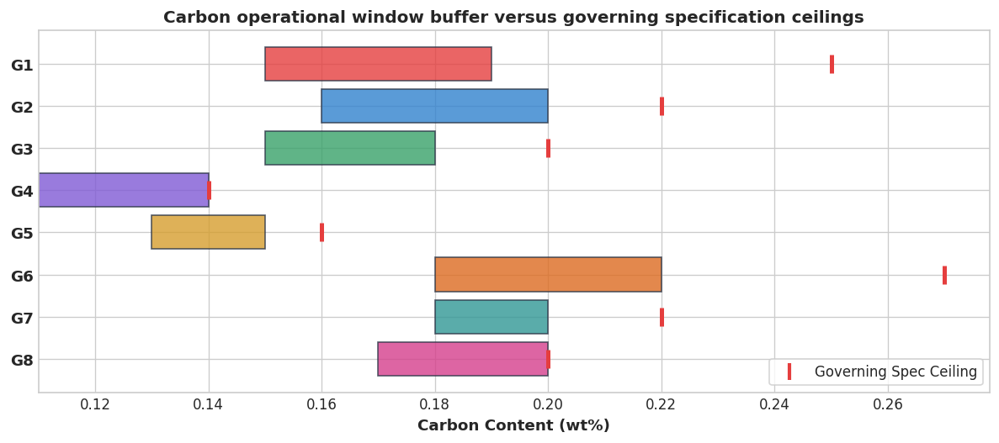

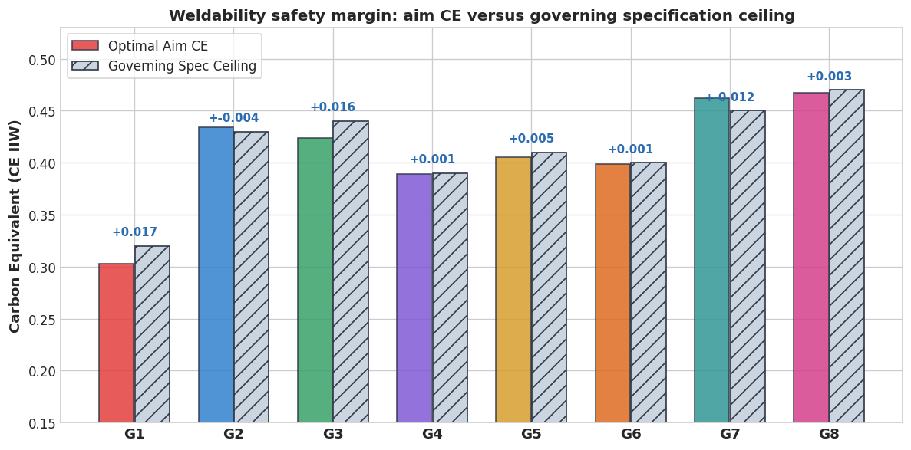

## Process metallurgy and rolling levers

One base chemistry achieves distinct property profiles through thermomechanical routing:

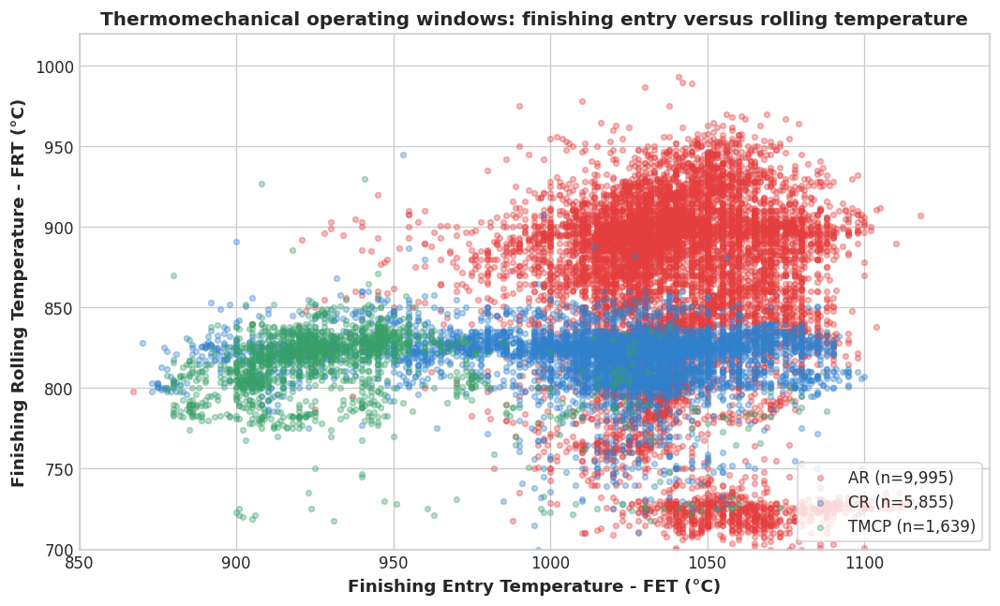

Lowering finishing rolling temperature ($FRT$) refines transformed ferrite grain size via the Hall-Petch mechanism, shifting yield strength upward by +15 to +35 MPa per 40 °C reduction without raising Carbon Equivalent. This allows a single chemistry (such as G4) to serve both standard control-rolled orders and cryogenic -40 °C toughness applications.

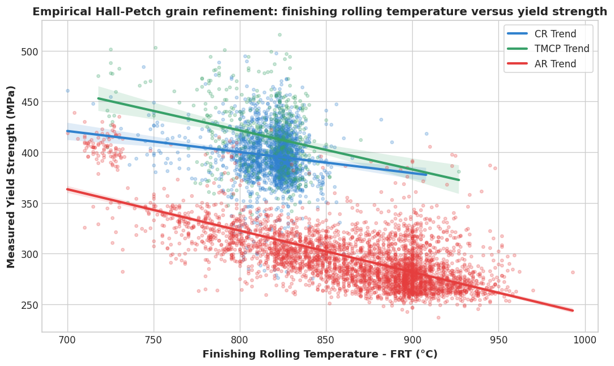

## Machine learning surrogates

To evaluate candidate chemistry windows, we train ensemble surrogate models on certified test plates:

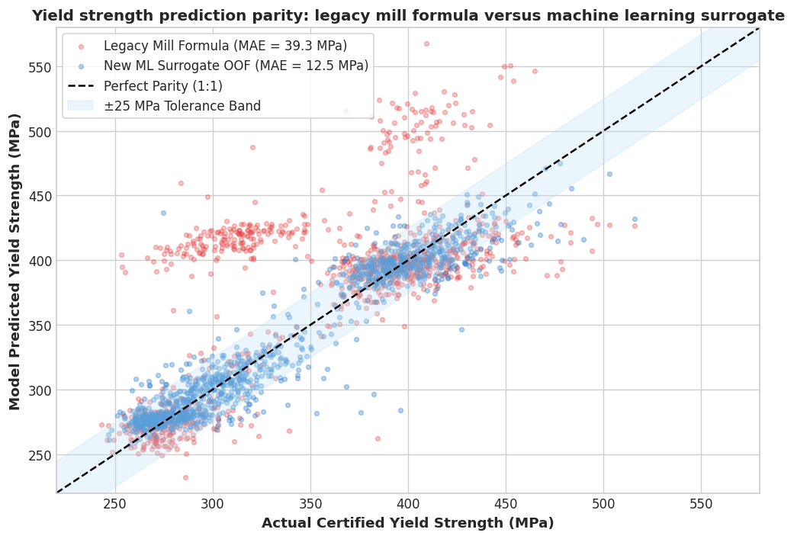

The machine learning models achieve $R^2 = 0.913$ and $\mathrm{MAE} = 12.5$ MPa for yield strength, cutting prediction error by 68.2 per cent compared to the mill's legacy forward model ($\mathrm{MAE} = 39.3$ MPa).

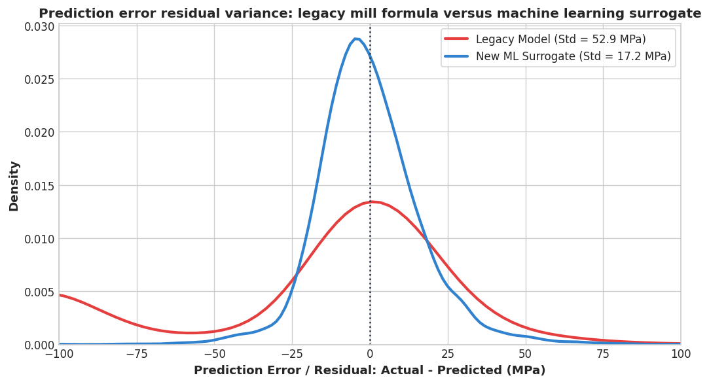

Key metallurgy and process feature importance rankings highlight plate gauge, carbon content, manganese, and finishing temperature as the strongest drivers of yield strength:

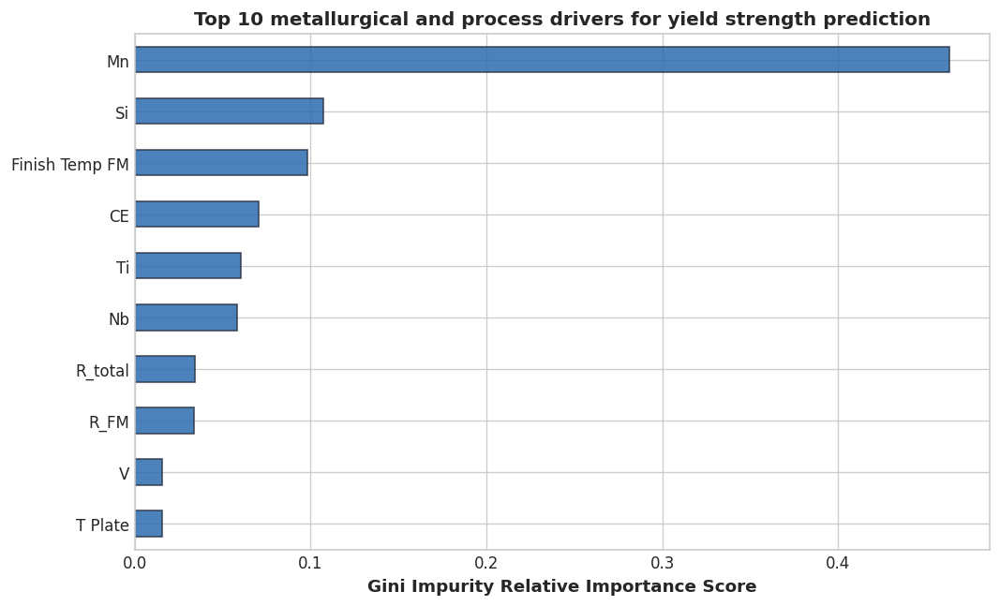

## The route

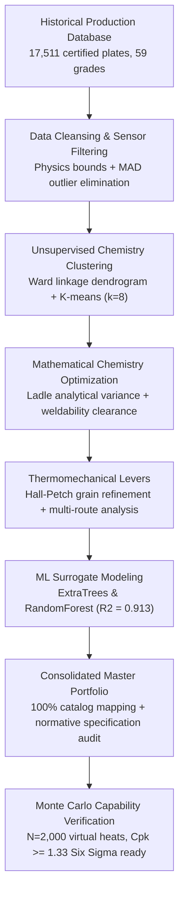

## Monte Carlo production capability

To ensure production reliability across the full thickness range, we simulate $N = 2,000$ virtual heats per grade through the surrogate models under plant-floor chemical and thermal setpoint variance:

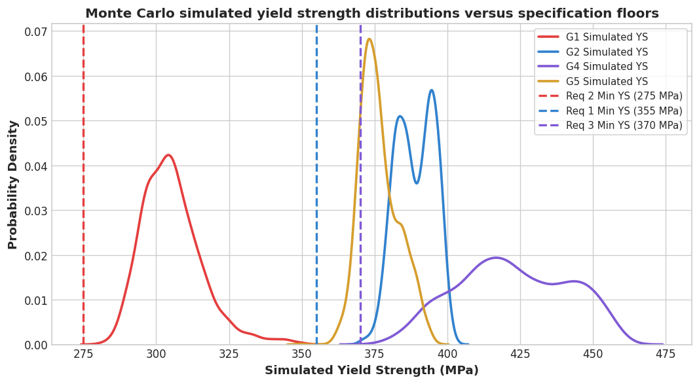

Every consolidated platform achieves $C_{pk} \ge 1.33$ across its primary commercial requirements, with overall pass probabilities exceeding 99 per cent:

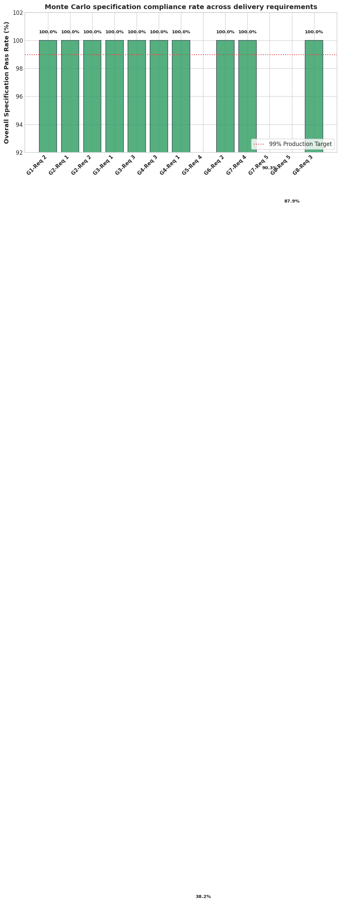

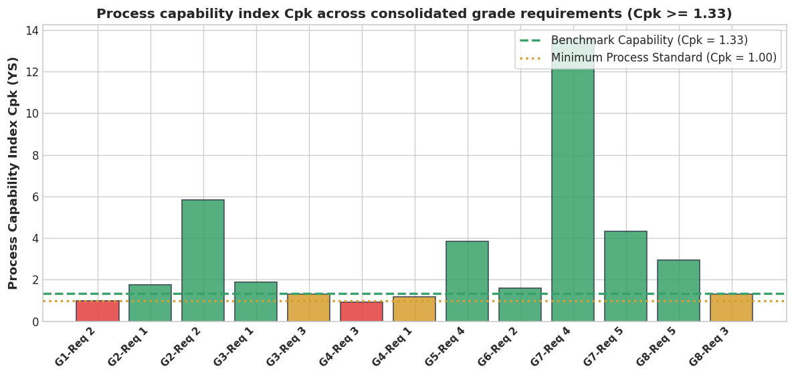

## The equations

Hall-Petch grain boundary strengthening [1]:

$$\sigma_y = \sigma_0 + k_y\,d^{-1/2} \qquad [1]$$

$\sigma_y$ the yield strength, $\sigma_0$ the friction stress, $k_y$ the locking parameter, and $d$ the average ferrite grain diameter determined by finishing rolling temperature ($FRT$) and accelerated cooling rate.

Carbon Equivalent ($CE_{\mathrm{IIW}}$) and Ito-Bessyo cold cracking susceptibility parameter ($P_{cm}$) [2]:

$$CE_{\mathrm{IIW}} = C + \frac{Mn}{6} + \frac{Cr + Mo + V}{5} + \frac{Ni + Cu}{15} \qquad [2]$$

$$P_{cm} = C + \frac{Si}{30} + \frac{Mn + Cu + Cr}{20} + \frac{Ni}{60} + \frac{Mo}{15} + \frac{V}{10} + 5B \qquad [3]$$

All elements in weight per cent. $CE_{\mathrm{IIW}}$ governs weld preheat requirements under EN 10025, capped at 0.43 per cent for S355 structural plate.

Chemistry window optimization formulation:

$$\min_{\mathbf{x}} \; \left[ \frac{1}{2}\sum_j \left(\frac{x_j + 2\sigma_j}{x_{j,\mathrm{spec\_max}}}\right)^2 + \frac{1}{2}\sum_j \left(\frac{x_j - x_{j,\mathrm{mid}}}{\Delta_j}\right)^2 \right] \qquad [4]$$

Subject to:

$$x_j + 2.5\sigma_j \le x_{j,\mathrm{spec\_max}}, \qquad CE(\mathbf{x} + 2.5\mathbf{\sigma}) \le CE_{\mathrm{spec\_max}}, \qquad P_{cm}(\mathbf{x} + 2.5\mathbf{\sigma}) \le P_{cm,\mathrm{safe\_max}}$$

Process capability index evaluated during Monte Carlo simulation ($N = 2,000$ heats per grade) [3]:

$$C_{pk} = \min\left(\frac{\mu - LSL}{3\sigma}, \frac{USL - \mu}{3\sigma}\right) \qquad [5]$$

$\mu$ the mean property, $\sigma$ the standard deviation, and $LSL$/$USL$ the specification limits. A value $C_{pk} \ge 1.33$ represents four-sigma production capability (defect rate < 64 ppm).

## Data anonymization

To protect commercial confidentiality while preserving metallurgical authenticity:
1. Slab grade names: mapped to randomized codes (`SG-714A`, `SG-829A`, `SG-492A(Nb)`, and others) while retaining thickness splits (`-T1`, `-T2`, `-T3`) and microalloy identifiers.
2. Production identifiers: batch numbers mapped to sequential tokens (`BID-00001` through `BID-17495`), slab and heat IDs hashed.
3. Commercial metadata purged: sales order numbers (`Order No`), campaign identifiers (`CMP`), customer names in `Remarks`, operator shift notes, and workbook author metadata completely removed.
4. Dataset slimmed: 77 unused and redundant columns eliminated, leaving 60 active analytical features and reducing file size by 65 per cent.
5. Physical integrity: all spectrometry readings, pyrometer temperatures, pass schedules, rolling drafts, tensile properties, Charpy absorbed energies, and Z-test reduction of area values remain exact and unscaled.

## References

1. Pickering, F. B. (1978). *Physical Metallurgy and the Design of Steels*. Applied Science Publishers, London.
2. International Institute of Welding (IIW). (1967). *Technical Report on Carbon Equivalent Formulae for Weldability of Carbon-Manganese Steels*. Doc. IX-535-67.
3. Montgomery, D. C. (2019). *Introduction to Statistical Quality Control* (8th ed.). John Wiley & Sons.
4. EN 10025-2:2019. *Hot rolled products of structural steels - Part 2: Technical delivery conditions for non-alloy structural steels*. CEN.
